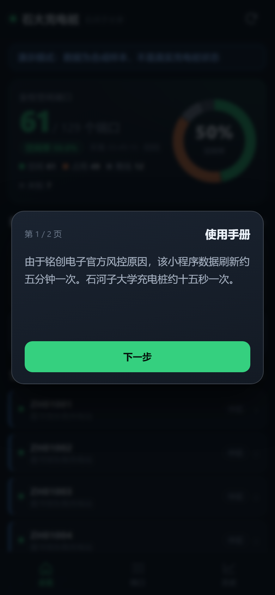
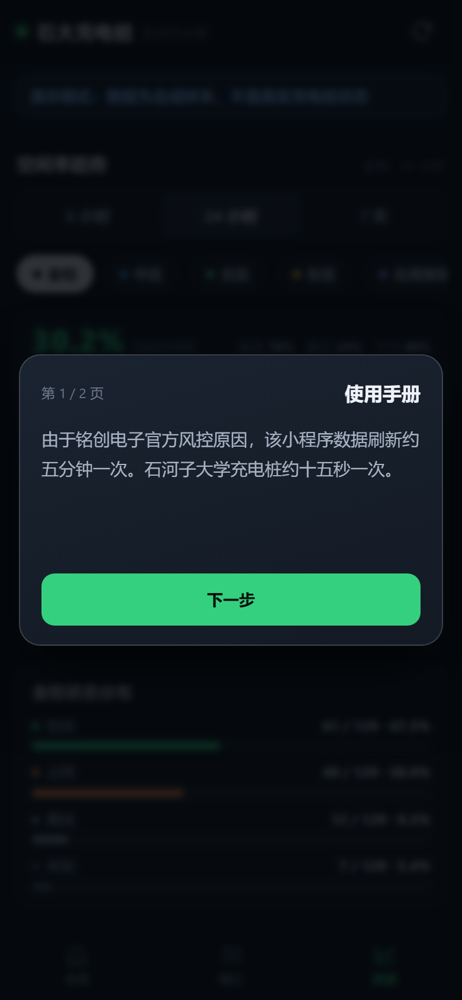
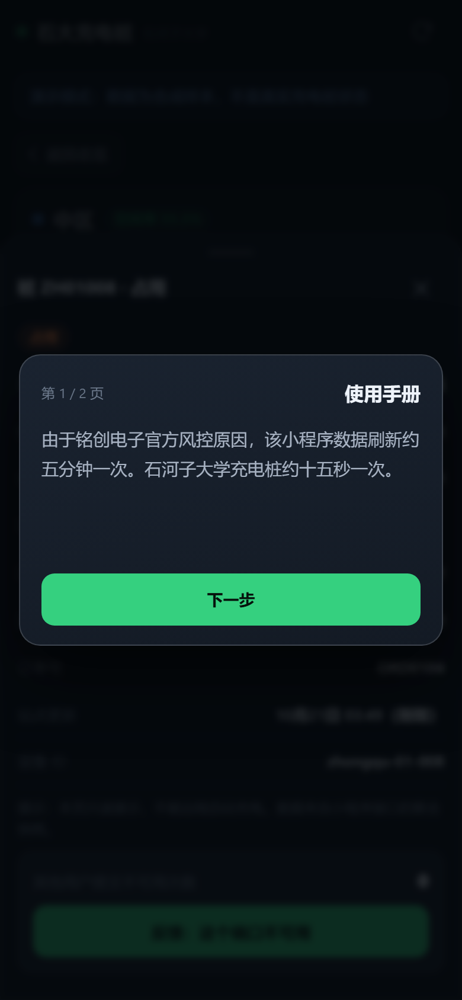
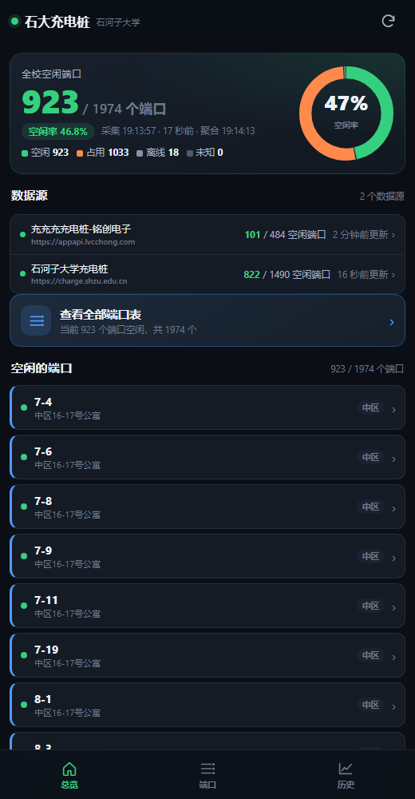

# 石大充电桩 · SHZU Charging

查石河子大学六个校区**充电桩空闲情况**的第三方小工具。

数据来自学校自己的充电桩接口（「石河子大学充电桩」）和铭创电子的「充充充充电桩」接口，
按 **中区 / 北区 / 东区 / 北苑新区 / 南区 / 将军山校区** 六个校区归类，精确到**每一个端口**：
哪个空着、哪个在充电、哪个坏了，全部用图表 + 端口列表直接看。



| 历史曲线 | 端口详情 |
| --- | --- |
|  |  |

---

## 目录

- [三种用法，先挑一种](#三种用法先挑一种)
  - [方式一：安卓 / 鸿蒙 —— 装 APK，打开即用](#方式一安卓--鸿蒙--装-apk打开即用)
  - [方式二：iPhone / iPad / 电脑 —— 直接用网址](#方式二iphone--ipad--电脑--直接用网址)
  - [方式三：自己部署到自己的电脑（局域网自用）](#方式三自己部署到自己的电脑局域网自用)
- [能查什么](#能查什么)
- [自部署：详细步骤](#自部署详细步骤)
- [自己编译 APK](#自己编译-apk)
- [公开接口](#公开接口)
- [项目结构](#项目结构)
- [常见问题](#常见问题)
- [说明](#说明)

---

## 三种用法，先挑一种

### 方式一：安卓 / 鸿蒙 —— 装 APK，打开即用

**不需要部署任何东西，装上就能看。**

1. 打开夸克网盘下载安装包：

   **<https://pan.quark.cn/s/bb6986b33540>**

   文件名：`shzu-charger.apk`（约 274 KB，包名 `cn.edu.shzu.charger`）
2. 手机上点开这个 apk 安装。系统提示「未知来源应用」时选「允许」即可
   （本 App 没上架应用商店，这是正常现象）。
3. 打开 App，直接就是实时数据。首次打开会有两页使用说明，看完点「我已知晓」。

> 鸿蒙（HarmonyOS 4 及以下 / 兼容安卓的版本）同样能装这个 apk。
> 如果你的鸿蒙版本不再支持安卓 apk，用下面的方式二，网页版功能一模一样。

APK 内已经内嵌了完整的前端界面，**没有网也能打开界面**（只是没数据）；
有网时它优先走公网数据，和网页版完全同步。

### 方式二：iPhone / iPad / 电脑 —— 直接用网址

苹果设备目前没有上架 App Store，**直接用浏览器打开网址**就行，功能一个不少：

**<https://shzucharge.xyz>**

- iPhone / iPad：Safari 打开 → 点「分享」→「添加到主屏幕」，
  之后从桌面图标打开，跟原生 App 的体验基本一样（全屏、无地址栏）。
- 电脑、其他手机、任何浏览器都可以直接访问。

### 方式三：自己部署到自己的电脑（局域网自用）

如果你不想用上面现成的服务，或者想**自己抓、自己看、数据完全在自己手里**，
可以在你自己的电脑上跑一份：一个 Python 脚本同时起「采集 + 本地网页服务」，
手机连同一个 Wi-Fi 就能访问。

- 电脑要求：Windows / macOS / Linux 都行，装了 **Python 3.8+**；
- 网络要求：**要在校园网内**（数据是从学校接口抓的，校外通常拿不到）；
- 不需要数据库、不需要 pip 装任何第三方库，**全部是 Python 标准库**。

| 自部署跑起来的样子（本机 relay + 两个数据源） |
| --- |
|  |

具体步骤见 [自部署：详细步骤](#自部署详细步骤)。

---

## 能查什么

- **六校区分别统计**：每个校区的总端口数、空闲数、占用数、故障数，以及空闲率环形图。
- **端口级状态**：一个充电桩有几个口、每个口是 `空闲 / 占用 / 故障 / 未知`，逐条列出。
- **空闲端口表**：所有空闲端口按校区分组列出，可按校区 / 状态 / 数据源筛选，点一行看详情。
- **历史曲线**：空闲率随时间变化的折线图，可切 24 小时 / 3 天 / 7 天。
- **数据源明细**：两个数据源各自贡献了多少端口、分校区各多少，一眼看出数据是不是齐的。
- **反馈**：某个端口明明空着却显示占用（或者反过来），可以在 App 里点一下反馈。

数据更新节奏：

| 数据源 | 覆盖 | 更新节奏 |
| --- | --- | --- |
| 石河子大学充电桩（学校官方接口） | 中区 / 北区 / 东区 / 北苑新区 / 将军山校区 | 采集约 15 秒一次，公网快照约 2 分钟一更 |
| 充充充充电桩-铭创电子 | 补上南区等站点（**南区只有这个源有**） | 采集约 5 分钟一次（对方有风控，刷太快会被拦） |

> 两个源必须**合并**才凑齐六个校区：学校接口里南区是 0 台，南区全部来自铭创源。

---

## 自部署：详细步骤

### 1. 准备

| 项 | 要求 |
| --- | --- |
| 系统 | Windows 10/11、macOS、Linux 都行 |
| Python | **3.8 或更高**（Windows 安装时记得勾选 `Add python.exe to PATH`） |
| 网络 | 校园网（或任何能访问 `charge.shzu.edu.cn` 的网络） |
| 手机 | 和电脑连**同一个 Wi-Fi** |

### 2. 拿到代码

```bash
git clone https://github.com/<你的用户名>/shzu-charging.git
cd shzu-charging
```

不会用 git 的话：在 GitHub 页面点绿色的 **Code → Download ZIP**，解压也行。

### 3. 启动

**Windows**：双击 `start-windows.bat`

**macOS / Linux**：

```bash
python3 start.py
```

启动后会打印类似这样的内容：

```
==================================================================
 石大充电桩 —— 本地服务
==================================================================
 正在启动 relay（0.0.0.0:8080）…
 relay 就绪。

 手机连同一个 Wi-Fi，浏览器打开下面任意一个：
     http://192.168.0.100:8080
 本机自测： http://127.0.0.1:8080

 采集节奏：石大源每 15s，铭创源每 300s
```

### 4. 手机打开

手机浏览器输入上面那个 `http://192.168.x.x:8080`，就是这个 App。

- 想更顺手：浏览器菜单里「添加到主屏幕」，以后一点就开。
- 自己编译的 APK 想默认连你这台电脑，见 [自己编译 APK](#自己编译-apk) 里的
  `RelayConfig.DEFAULT_RELAY`。

### 5. 可选参数

```bash
python start.py --port 9000           # 换端口（默认 8080）
python start.py --shzu-interval 10    # 石大源 10 秒一轮（默认 15）
python start.py --lvcc-interval 600   # 铭创源 10 分钟一轮（默认 300，别调太小）
python start.py --workers 24          # 石大源并发数（默认 16）
python start.py --no-lvcc             # 只采石大源（校外网络下铭创常被风控）
```

Windows 上给 bat 传参：`start-windows.bat --port 9000`，或者在命令行里
`py -3 -X utf8 start.py --port 9000`。

### 6. 停止

在那个黑窗口按 `Ctrl+C`，采集循环和网页服务会一起停掉。

### 7. 想让它开机就跑？

自带的 `start.py` 是前台进程。想常驻可以用系统自带的能力：

- **Windows**：任务计划程序 → 新建任务 → 触发器「登录时」→ 操作填
  `pythonw.exe D:\路径\start.py`；
- **Linux**：写成 systemd service 或 `nohup python3 start.py &`；
- **macOS**：`launchd` 或 `nohup python3 start.py &`。

---

## 自己编译 APK

`android/` 目录里是 APK 的**全部源码**（Java + 资源 + 构建脚本），
**不用 Android Studio、不用 gradle**，只用 Android SDK 里 build-tools 的命令行工具
（`aapt2`、`d8`、`zipalign`、`apksigner`）手工串起来。

### 需要装什么

1. **JDK 17**
2. **Android SDK**（只需要这两块，装法随意，Android Studio 的 SDK Manager 也可以）：
   - `platforms;android-34`（提供 `android.jar`）
   - `build-tools;34.0.0`（提供 aapt2 / d8 / apksigner / zipalign）

### 打包

```powershell
cd android
# 自动探测 SDK / JDK；探不到就显式指定
.\build.ps1 -WithApp -SdkRoot "C:\Android\Sdk" -JavaHome "C:\Program Files\Java\jdk-17"
```

- `-WithApp`：把 `../app` 的前端文件打进 `assets/app`（离线兜底界面，推荐带上）
- `-Clean`：先清掉 `build/`、`dist/`
- `-RecreateKeystore`：重建调试签名证书

产物：`android/dist/shzu-charger.apk`

> 想让自编译的 APK 默认连你自己的电脑，改
> `android/src/cn/edu/shzu/charger/RelayConfig.java` 里的
> `DEFAULT_RELAY`（默认占位是 `http://192.168.0.100:8080`）。
> App 里的中继地址也可以在安装后用 `?relay=` 参数或 localStorage 覆盖。

---

## 公开接口

线上服务提供只读 JSON 接口（有速率限制，每分钟 20 次/客户端）：

| 接口 | 说明 |
| --- | --- |
| `GET https://api.shzucharge.xyz/health` | 存活状态、数据新鲜度、端口总数 |
| `GET https://api.shzucharge.xyz/snapshot` | 当前快照（六校区 + 站点 + 端口，精简编码） |
| `GET https://api.shzucharge.xyz/history?hours=24&bucket=5m` | 空闲率历史点（5 分钟粒度，最多 7 天） |

自部署时同样的接口在你自己的地址上：`http://<电脑IP>:8080/api/health`、
`/api/snapshot`、`/api/history`。

---

## 项目结构

```
.
├── start.py                # 自部署一键启动（relay + 采集循环）
├── start-windows.bat       # Windows 双击入口
├── app/                    # 前端（纯静态：原生 JS + 手写 SVG 图表，零构建、零依赖）
│   ├── index.html          #   单页骨架（总览 / 端口 / 历史）
│   ├── app.js              #   页面逻辑、渲染
│   ├── charts.js           #   手写 SVG 图表（环形图、折线图、条形图）
│   ├── api.js              #   数据获取：本机 relay → 公网 → 本地缓存，逐级回退
│   ├── config.js           #   运行时配置（中继地址、限流参数等）
│   └── sw.js               #   Service Worker（离线缓存）
├── relay/                  # 局域网 HTTP 服务（Python 标准库，SQLite 存档）
│   ├── server.py           #   /api/* + 静态托管 ../app/
│   ├── aggregate.py        #   多源合并、按校区归类、快照生成
│   └── store.py            #   SQLite 存储 + 历史
├── sniffer/
│   ├── real_collect.py     # 采集器：轮询两个真实接口 → shzu.ingest.v1 → POST 给 relay
│   └── netdns.py           # 采集时的 DNS 兜底
├── shared/                 # 契约与单一事实来源
│   ├── campus.json         #   六个校区 + 别名表（归类就靠它）
│   └── contract.md         #   数据结构契约
└── android/                # APK 源码（Java + 资源 + 免 gradle 构建脚本）
    ├── src/                #   Java 源码（WebView 壳）
    ├── res/                #   图标、字符串、布局
    ├── build.ps1           #   手工打包：aapt2 → javac → d8 → zipalign → apksigner
    └── dist/               #   已签名的成品 apk
```

技术要点：

- **前端零依赖**：没有 npm、没有打包工具、没有 CDN，图表是手写 SVG，直接打开 `app/index.html` 就能跑。
- **数据链路**：采集器 → relay（SQLite）→ 前端；公网版本是 采集器 → Cloudflare Worker（KV）→ 前端。
- **归类规则**：校区别名表在 `shared/campus.json`，采集和聚合两侧共用同一张表，
  避免"设备名写南区、地址字段写北区"这类互相打架的情况。

---

## 常见问题

**Q：手机打不开 `http://192.168.x.x:8080`？**
1. 确认手机和电脑连的是**同一个 Wi-Fi**（不是一个连 Wi-Fi、一个用流量）；
2. Windows 第一次启动会弹防火墙询问，要选「允许访问」（专用网络要打勾）；
3. 电脑上 `ipconfig`（macOS/Linux 用 `ifconfig`）看一下真实局域网 IP，别用打印出来的旧地址；
4. 公司/学校 Wi-Fi 有时开了「AP 隔离」，设备之间互相访问不了，换成手机热点试试。

**Q：启动后一直没数据 / 提示采集失败？**
- 石大源需要**校园网**环境，校外通常报连接失败；
- 铭创源有风控，短时间内反复失败是正常的，它会自动退避，过几分钟再看；
- 看 `http://127.0.0.1:8080/api/health` 里的 `last_error` / `consecutive_failures`。

**Q：南区一直是 0？**
南区全部来自铭创源。如果你用了 `--no-lvcc`，或者铭创源被风控，
南区就没有数据——这是数据源本身的覆盖问题，不是程序坏了。

**Q：端口数比官方小程序少/多？**
两个源的统计口径不完全一样（有的把整桩算一个、有的按端口算）。
本工具统一按**端口**计数，同一站点两源重复时以先到的为准。

**Q：会不会封号 / 要登录吗？**
不需要登录，也不涉及任何账号。两个接口本来就是小程序在不登录状态下调用的公开接口。
但请**不要**把轮询间隔改得特别小（尤其铭创源），对方有风控，刷太猛会被临时封 IP。

**Q：APK 为什么要从网盘下，不直接放 GitHub？**
GitHub 对 apk 二进制不太友好（Release 之外的文件会拖慢仓库）。
仓库里的 `android/dist/shzu-charger.apk` 是同步的副本，两个地方是同一个文件。

---

## 说明

- 本项目是**非官方**工具，和学校、和铭创电子都没有关系，只是把公开接口的数据整理得好看一点。
- 数据版权归原数据提供方；本项目只做展示，不做二次分发以外的用途。
- 接口随时可能变（对方改版就抓不到了），本项目不保证永远可用。
- 代码以 MIT 协议开源，详见 [LICENSE](LICENSE)。